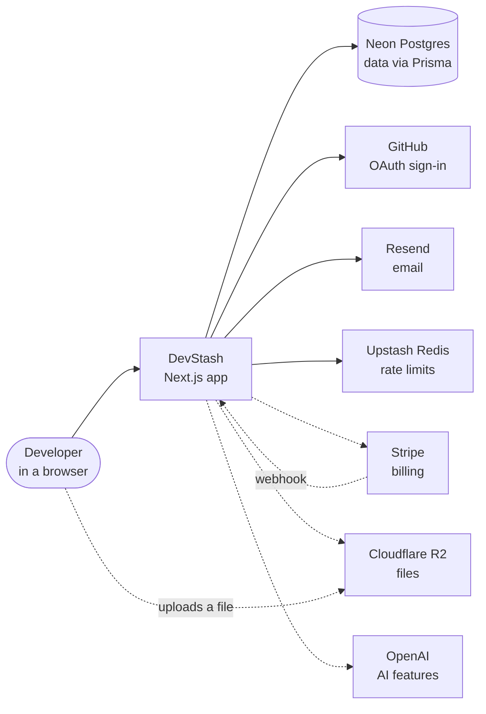

# DevStash in one page (arc42-lite)

A short architecture description in the [arc42](https://arc42.org/) shape, with only the sections that help a newcomer: 1 goals, 3 context, 5 building blocks, 9 decisions. The others (constraints, runtime views, deployment, concepts, quality tree, risks, glossary) are in [architecture.md](architecture.md) or will be written when the flows exist: the Stripe webhook, the upload and the AI stream.

## 1. Introduction and goals

DevStash is a hub where a developer keeps snippets, prompts, commands, notes, files, images and links in one searchable place, grouped in collections. Free users get 50 items and 3 collections; Pro adds file uploads, custom types, AI features and export (see [project-overview.md](../context/project-overview.md)).

What the architecture has to deliver, in order:

1. **A user sees only their own data.** Every query and write carries the owner
2. **A newcomer or an AI assistant knows where code goes.** One role per file, ranked features, checks in the lint
3. **A feature can be added without touching the others.** One-way dependencies, no cycles

## 3. Context and scope



Solid lines exist in the code today, dashed lines are planned. The app is hosted on Vercel.

| System | Used for | Reached through | Status |
| ------ | -------- | --------------- | ------ |
| Neon Postgres | all data | `lib/prisma.ts` (`@prisma/adapter-pg`) | in use |
| GitHub | OAuth sign-in | NextAuth in `auth/nextauth` | in use |
| Resend | verification and reset emails | `lib/email.ts` | in use |
| Upstash Redis | rate limits | `lib/rate-limit.ts` | in use |
| Stripe | subscriptions and webhooks | `lib/stripe.ts`, owned by `billing` | planned |
| Cloudflare R2 | files and images | `lib/r2.ts`, owned by `files` | planned |
| OpenAI | tags, explanations | `lib/openai.ts`, owned by `ai` | planned |

A vendor SDK is imported only inside `lib/`; what the vendor means for the product stays in the feature ([ADR 0002](adr/0002-boundaries-enforced-by-eslint.md)).

## 5. Building block view

```text
app            routes and page composition only
features       auth, item-types, items, collections, app-shell      (built)
               billing, files, editor, ai, search, import-export, account   (planned)
components/ui  shadcn primitives          lib   infrastructure and vendor clients
```

A feature imports only features of a lower rank. What each module owns, uses and exposes is in [modules.md](modules.md); the ranks and the placement rules are in [architecture-rules.md](../context/architecture-rules.md); the worked example and the request flows are in [architecture.md](architecture.md).

## 9. Architecture decisions

| Decision | Record |
| -------- | ------ |
| Modular monolith with ranked features | [0001](adr/0001-modular-monolith-with-ranked-features.md) |
| Boundaries are enforced by ESLint | [0002](adr/0002-boundaries-enforced-by-eslint.md) |
| Every write goes through a service | [0003](adr/0003-services-for-every-write.md) |
| Files go from the browser straight to R2 | [0004](adr/0004-direct-upload-to-r2.md) |
| Entitlements from the database; billing owns its data | [0005](adr/0005-entitlements-from-the-database.md) |
| ESLint 9 because of `eslint-plugin-import` | [0006](adr/0006-eslint-9-and-eslint-plugin-import.md) |
